# Homeo-Hall

**Homeopathic Medicine Inventory & Financial Management System (HPMS)**

Homeo-Hall is a private, single-owner Laravel application for a homeopathic chamber in Bangladesh. It replaces paper stock registers and manual profit calculations with a clear inventory ledger, expense records, live dashboards, and date-range financial reports.

> This is deliberately a focused chamber tool, not a pharmacy ERP. It has no patients, prescriptions, customers, online orders, payment gateways, employees, suppliers module, roles, or public registration.

## Features

- Secure owner-only sign-in, login throttling, and logout. Registration is not exposed.
- Medicine inventory with potency-aware identity, categories, search, filters, sorting, low-stock and out-of-stock views.
- Purchases with multiple line items, automatic totals, weighted-average costing, and atomic cancellation.
- Sales with live stock checks, editable selling prices, preserved historical cost, and atomic cancellation.
- Stock adjustments with reasons and a complete stock-movement ledger.
- Chamber expenses and expense categories, separate from medicine purchases.
- Dashboard cards, current-month summary, recent activity, and four live Chart.js charts.
- Daily, monthly, yearly, custom-range, inventory, medicine-wise sales, expense, low-stock, and stock-movement reports.
- PDF, XLSX, CSV, and browser-print exports that keep the selected date range.
- Settings for chamber name, owner name, currency, timezone, low-stock default, report period, and password.
- Business-data ZIP export and documented MySQL backup/restore process.
- Responsive, print-friendly interface based on [`DESIGN.md`](DESIGN.md).

## Stack

| Layer | Technology |
|---|---|
| Language | PHP 8.4 |
| Framework | Laravel 13 |
| Database | MySQL 8.x |
| Frontend | Blade, Tailwind CSS 4, Alpine.js |
| Charts | Chart.js |
| Icons | Inline Lucide SVG paths |
| PDF | `barryvdh/laravel-dompdf` |
| XLSX | Dependency-free `App\Support\SimpleXlsxWriter` |
| Build | Vite |
| Tests | PHPUnit feature tests |

## Requirements

- PHP 8.3 or newer with `pdo_mysql`, `mbstring`, `openssl`, `tokenizer`, `xml`, `ctype`, `json`, `bcmath`, and `fileinfo`.
- Composer 2.
- Node.js 20+ and npm.
- MySQL 8.x.
- No paid service is required for core functionality.

`maatwebsite/excel` is intentionally not installed: its PhpSpreadsheet dependency currently requires the PHP `ext-gd` extension, which is absent in this environment. The small built-in XLSX writer is used instead and produces a standard one-sheet workbook. See [Limitations](#limitations).

## Installation

```bash
cd hpms
composer install
cp .env.example .env
php artisan key:generate
```

Create the MySQL database and update the `DB_*` values in `.env`:

```sql
CREATE DATABASE homeo_hall CHARACTER SET utf8mb4 COLLATE utf8mb4_unicode_ci;
```

Install frontend dependencies, migrate, and provision the owner:

```bash
npm install
php artisan migrate
```

Set **both** owner variables in `.env` before seeding:

```dotenv
OWNER_EMAIL=owner@example.com
OWNER_PASSWORD="a-long-unique-password"
OWNER_NAME="Chamber Owner"
```

Then run:

```bash
php artisan db:seed
```

The seeder creates the default medicine and expense categories, default settings, and the owner account. It never creates sample transactions. If only one of `OWNER_EMAIL` or `OWNER_PASSWORD` is present, it stops with an error rather than creating a partially configured account. Keep `OWNER_PASSWORD` out of version control; after provisioning you may remove it from the environment.

Build assets and start the app:

```bash
npm run build
php artisan serve
```

Open `http://127.0.0.1:8000/login`.

### Development commands

```bash
composer run dev       # Laravel server, queue listener, logs, and Vite
npm run dev            # Vite only
php artisan migrate    # Apply pending migrations
php artisan optimize:clear
```

### Tests

```bash
php artisan test --compact
```

The suite uses an in-memory SQLite database configured by `phpunit.xml`. It never touches the MySQL development or production database. See [`docs/TESTING.md`](docs/TESTING.md).

## Environment notes

- `APP_TIMEZONE=Asia/Dhaka` is the application default. The saved timezone setting also applies at boot.
- `APP_DEBUG=false` and `APP_ENV=production` in production.
- Use `SESSION_ENCRYPT=true` and `SESSION_SECURE_COOKIE=true` when serving over HTTPS. Keep `SESSION_SECURE_COOKIE=false` for local HTTP development.
- `SESSION_HTTP_ONLY=true` and `SESSION_SAME_SITE=lax` are the secure defaults.
- Do not commit `.env`, database dumps, or owner credentials.
- `/health` returns JSON with `{"status":"ok","database":"ok"}` and a `503` when the database is unreachable.

## Backup and restore

### Full database backup

Run from the project directory, replacing the user and database name:

```bash
mysqldump --single-transaction --routines --triggers -u root -p homeo_hall > homeo-hall-$(date +%F).sql
```

Store the dump outside the web root and keep more than one dated copy. The dump contains the owner password hash, so protect it like a credential.

Restore into an empty database:

```bash
mysql -u root -p homeo_hall < homeo-hall-YYYY-MM-DD.sql
php artisan optimize:clear
```

### Business-data export

**Settings → Data backup** downloads a ZIP containing CSV files for medicines, purchases, purchase items, sales, sale items, expenses, stock adjustments, and stock movements. It intentionally omits users, password hashes, settings, and sessions. It is useful for inspection or migration, but it is **not** a complete restorable database backup. Use `mysqldump` for disaster recovery.

## Security

- Passwords are hashed with Laravel's hasher; the password-change form requires at least 12 characters and the current password.
- Login is rate-limited and all business routes use the `auth` middleware.
- CSRF protection is enabled on every form.
- Validation is server-side; browser calculations are convenience only.
- Mass assignment is limited by model fillable fields; exports are authenticated.
- Owner credentials are never hardcoded. Provisioning happens only through environment variables.
- The session and all business data are restricted to the authenticated owner.

## Deployment (Render Free + TiDB Cloud Starter + Cloudflare R2)

A Docker/Render configuration is included but **nothing is deployed automatically** and no cloud resources are created by this repository. Target architecture:

- **Render Free** Docker Web Service (`homeo-hall`), Apache + PHP 8.4, health check `/up`.
- **TiDB Cloud Starter** (MySQL protocol, port 4000, TLS) for all relational data.
- **Cloudflare R2** (private bucket) for permanent uploads; the app serves them through `/media/{path}` instead of a public bucket or `public/storage`.
- Sessions and cache use database tables, so restarts do not log users out. Queues stay `sync` (no worker on Free).

Key files: [`Dockerfile`](Dockerfile), [`docker/`](docker), [`render.yaml`](render.yaml), [`.env.production.example`](.env.production.example).

Order of work (details and exact commands in [`docs/DEPLOYMENT_GUIDE.md`](docs/DEPLOYMENT_GUIDE.md)):

1. Push the repository to GitHub `main`.
2. Create the TiDB Starter instance and `homeo_hall` database.
3. Create the private R2 bucket and an Object Read & Write API token.
4. Back up local MySQL and verify the dump.
5. Import the dump into TiDB and verify counts, totals, Unicode and locking.
6. Dry-run and run `php artisan uploads:migrate --from=public --to=s3`.
7. Create the Render service, fill the environment variables, and deploy.
8. Update `APP_URL`, test login/reports/uploads, and configure backups.

Free-tier realities: Render sleeps after ~15 minutes idle (~1 minute cold start), has 512 MB RAM and no shell/persistent disk; TiDB Starter has a monthly RU quota and blocks new connections when exhausted; uploads must live in R2. Render does not recommend Free for production. Cloud checks are **not run** in this repository — see the audit for what remains to be verified.

Documentation:

- [`docs/DEPLOYMENT_AUDIT.md`](docs/DEPLOYMENT_AUDIT.md) — versions, compatibility findings, risks.
- [`docs/DEPLOYMENT_GUIDE.md`](docs/DEPLOYMENT_GUIDE.md) — step-by-step manual deployment.
- [`docs/DATABASE_MIGRATION_GUIDE.md`](docs/DATABASE_MIGRATION_GUIDE.md) — backup, import and verification.
- [`docs/FILE_STORAGE_MIGRATION_GUIDE.md`](docs/FILE_STORAGE_MIGRATION_GUIDE.md) — moving uploads to R2.
- [`docs/BACKUP_AND_RESTORE.md`](docs/BACKUP_AND_RESTORE.md) — production backups and restore drills.
- [`docs/DEPLOYMENT_TROUBLESHOOTING.md`](docs/DEPLOYMENT_TROUBLESHOOTING.md) — 500/502, TLS, R2, sessions, PDFs.

Do not deploy with local credentials. Never commit `.env`, dumps, or R2 secrets, and never run `migrate:fresh`, `db:wipe`, or an automatic rollback against production.

## Troubleshooting

| Symptom | Check |
|---|---|
| `could not find driver` | Enable `pdo_mysql` in PHP. |
| Login loops back | Clear config and sessions: `php artisan optimize:clear`. |
| Owner seeding does nothing | Set both `OWNER_EMAIL` and `OWNER_PASSWORD`; run `php artisan db:seed`. |
| Assets missing | Run `npm run build`; ensure `public/build` exists. |
| Date-range report is empty | Use the transaction's actual date; the range is inclusive of both full days. |
| Export fails | Check `storage/` and PHP memory; PDF and XLSX are generated on demand. |
| MySQL error on migration | Confirm MySQL 8, utf8mb4, and a database name without hyphens unless quoted. |

## Documentation

- [`docs/SYSTEM_GUIDE.md`](docs/SYSTEM_GUIDE.md) — how every page works, the Laravel classes used, business formulas and database transactions.
- [`docs/SYSTEM_GUIDE_Bn.md`](docs/SYSTEM_GUIDE_Bn.md) — ওই কারিগরি নির্দেশিকাটির বাংলা সংস্করণ।
- [`docs/USER_MANUAL_BN.md`](docs/USER_MANUAL_BN.md) — সহজ বাংলায় ব্যবহার নির্দেশিকা (non-technical staff manual).
- [`docs/USER_MANUAL_BN.pdf`](docs/USER_MANUAL_BN.pdf) — প্রিন্ট ও বিতরণের জন্য A4 PDF (২৫ পৃষ্ঠা, পর্দার ছবিসহ)।
- [`docs/PROJECT_OVERVIEW.md`](docs/PROJECT_OVERVIEW.md) — scope, modules, structure.
- [`docs/DATABASE_SCHEMA.md`](docs/DATABASE_SCHEMA.md) — tables, relationships, precision.
- [`docs/BUSINESS_LOGIC.md`](docs/BUSINESS_LOGIC.md) — formulas, average costing, cancellations.
- [`docs/INSTALLATION.md`](docs/INSTALLATION.md) — local setup and server checklist.
- [`docs/TESTING.md`](docs/TESTING.md) — test coverage and manual QA.
- [`docs/DEPLOYMENT_GUIDE.md`](docs/DEPLOYMENT_GUIDE.md) — Render, TiDB and R2 setup.

### Rebuilding the Bangla manual PDF

Edit [`docs/USER_MANUAL_BN.md`](docs/USER_MANUAL_BN.md), then run:

```bash
python3 docs/build_user_manual_pdf.py
```

The script regenerates `docs/USER_MANUAL_BN.pdf` with the cover page, contents page and house styling from `docs/manual/` (template, stylesheet, logo). Screenshots live in `docs/screenshots/`. It needs `pandoc`, WeasyPrint and the Noto Sans Bengali font; no database or app server is involved.

## User Manual (English)

A visual walkthrough of every screen for chamber owners and staff. The same content, with full Bangla explanations, is in [`docs/USER_MANUAL_BN.md`](docs/USER_MANUAL_BN.md) and the printable [`docs/USER_MANUAL_BN.pdf`](docs/USER_MANUAL_BN.pdf). All screenshots below come from a demo chamber; medicine names, dates and amounts will differ in your chamber, but the screens are the same.

### Signing in

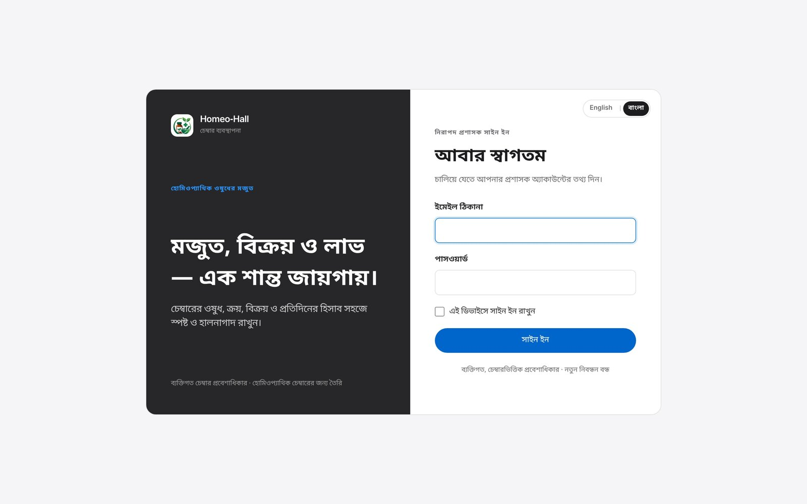

Open the chamber URL in Chrome, Edge, Firefox or Safari and enter the **email** and **password** your chamber owner or system admin created for you. Tick **Keep me signed in on this device** only on a personal computer. The **EN | বাংলা** switch at the top right changes the whole interface and is remembered on your account. Registration is not exposed, and there is no self-service password reset — ask the owner or admin. Five wrong attempts for the same email and IP within a minute trigger a short wait.

### Dashboard

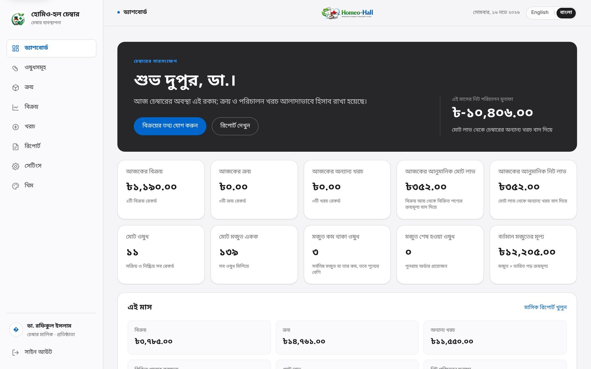

The dashboard is the chamber at a glance: today's sales, purchases and other expenses, estimated gross profit (sales minus the cost of the medicines sold), estimated net profit (gross profit minus other expenses), total medicines, total stock units, low-stock and out-of-stock counts, and the value of stock on hand. Below it sit the current-month summary, four six-month charts, recent activity and stock alerts. The quick-action buttons jump straight to adding a medicine, purchase, sale or expense.

### Medicines

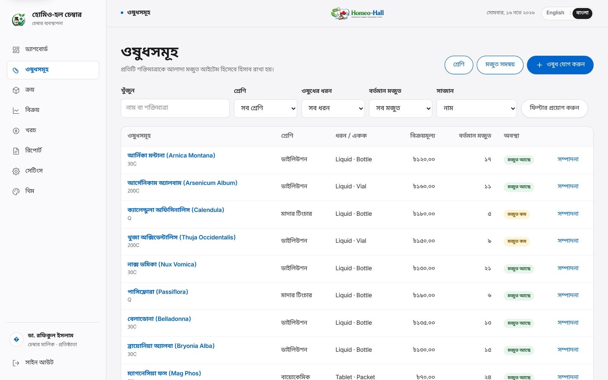

**Medicines** lists every medicine with its potency, category, type, unit, stock, prices and status. Search by name or potency, filter by category, type or stock state (low stock / out of stock), and sort by name, stock, price or date. Each row links to the medicine's detail page and to editing.

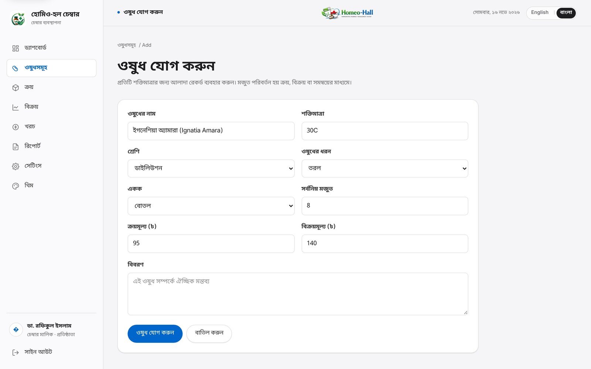

To add a medicine, choose **Add medicine** and fill in the name, potency, category, medicine type, unit, reorder level, purchase price and selling price, then save. There is deliberately no stock field: stock only moves through purchases, sales and stock adjustments, which keeps the ledger consistent. Each potency is a separate medicine — for example *Nux Vomica 30C* and *Nux Vomica 200C* are two records with separate stock.

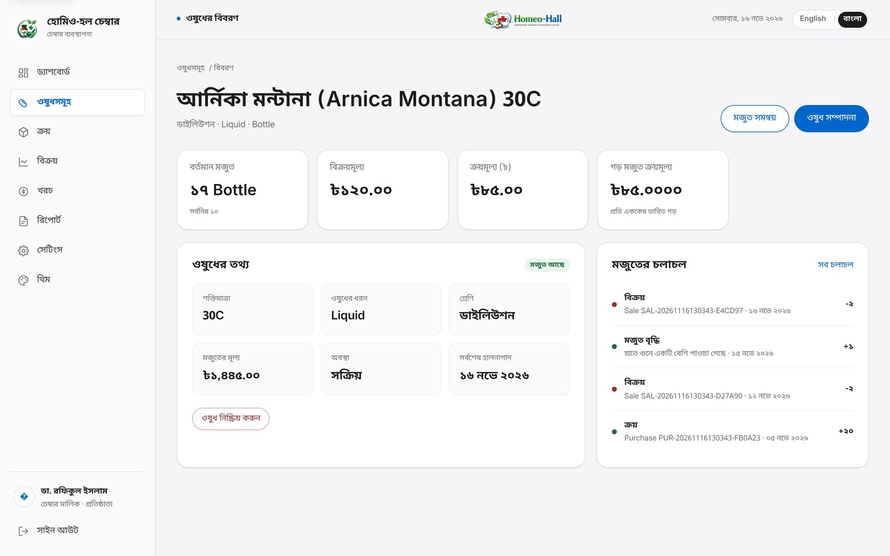

The detail page shows current stock, weighted-average purchase cost, selling price, stock value and the complete stock-movement history, so every increase and decrease can be traced. Editing changes names, prices and categories but never stock. **Deactivate medicine** hides a medicine from new purchases and sales while keeping its history intact; categories work the same way and cannot be deleted.

### Stock adjustments

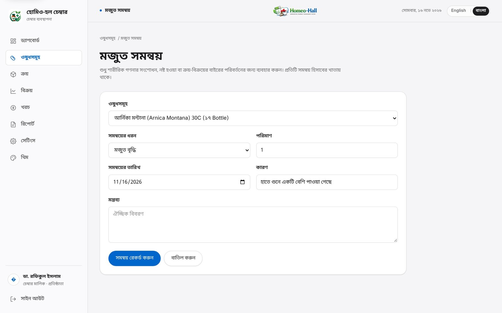

Use **Stock adjustment** only when the physical count does not match the system, or when stock is damaged or expired. Choose the medicine, whether stock increases or decreases, the quantity, the date and a **reason** (for example "counted less" or "broken bottle"); the reason is stored permanently. Stock can never go below zero.

### Purchases

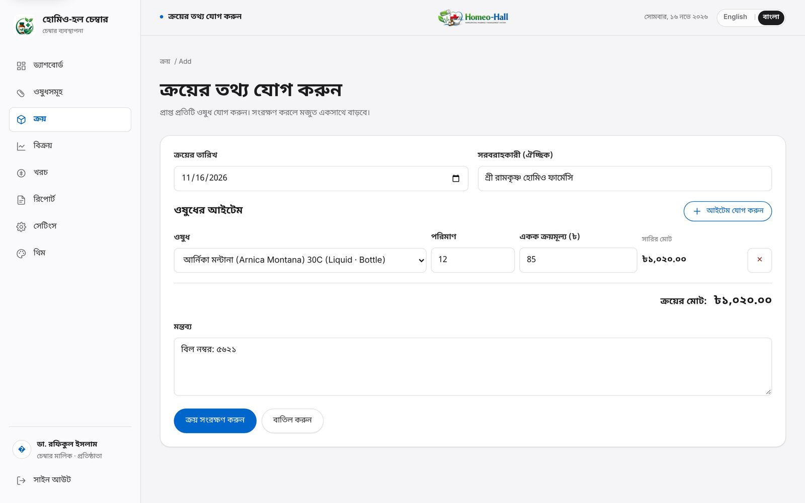

A purchase records medicines bought: date, optional supplier name, medicine, quantity and unit cost, with **Add item** for more lines and **Remove item** to drop a row. The line and purchase totals add up automatically. Saving raises each medicine's stock, recalculates its weighted-average cost and writes a purchase entry to the ledger.

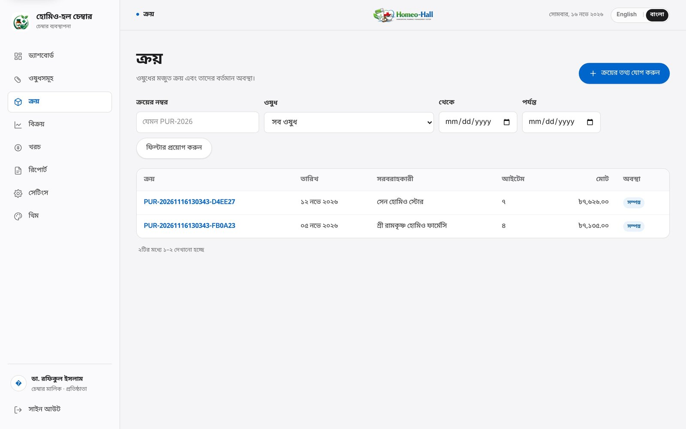

The purchase list shows every purchase with its number, date, supplier and total; open a row to see its items. **Cancel purchase** requires a reason and reverses the stock, but is blocked when the purchased medicine has since been sold or adjusted — correct that sale or adjustment first, so historical profit stays accurate.

### Sales

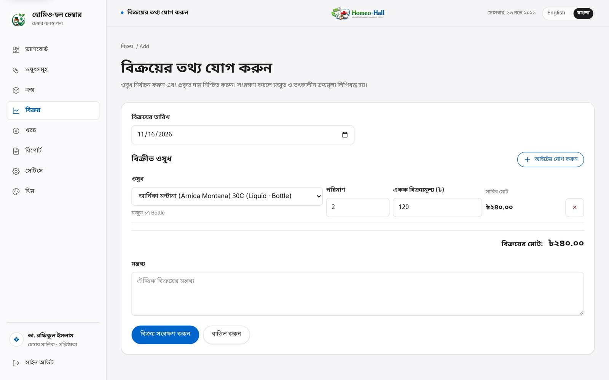

A sale records medicines sold: date, medicine, quantity and unit selling price, with multiple lines and an automatic total. Choosing a medicine shows its current stock and price; the price can be changed for a discount and that price is what the reports use. You cannot sell more than the available stock. Saving reduces stock, freezes the average cost at the moment of sale (so later price changes never rewrite old profit) and writes a sale entry.

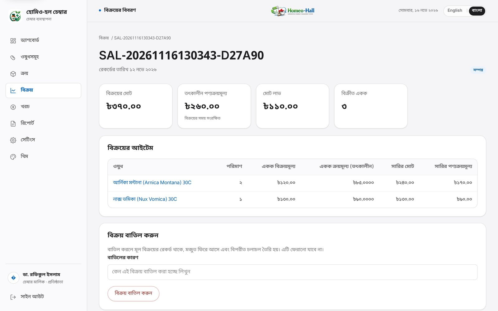

The sale detail shows the total, the cost of the goods at sale time, the profit, the units sold and the cancellation box. **Cancel sale** needs a reason and puts the stock back; a sale can only be cancelled once.

### Expenses

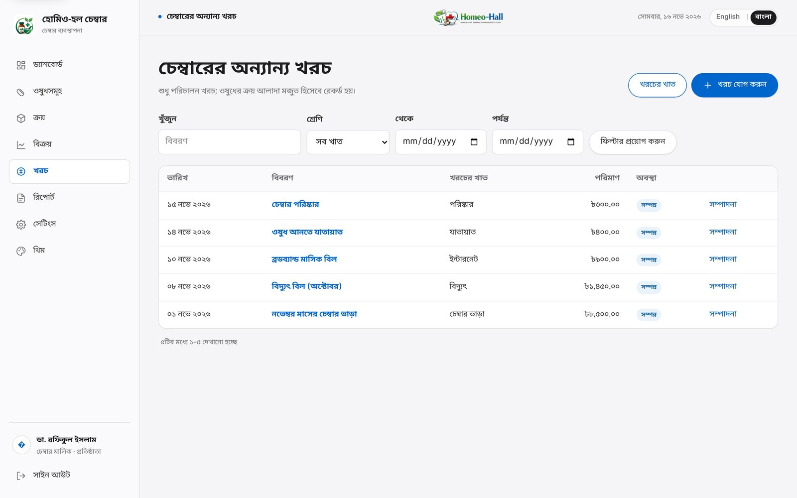

**Expenses** records chamber running costs such as rent, electricity and internet, separately from medicine purchases. Each entry has a date, description, category and amount. Completed expenses can be edited; cancelled ones cannot. Manage the category list (for example "mobile recharge") from the expense-categories page.

### Reports and exports

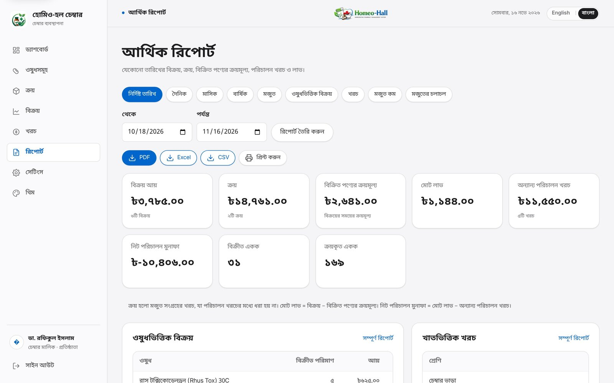

**Reports** covers daily, monthly, yearly and custom date ranges plus inventory, medicine-wise sales, expenses, low stock and stock movement. Pick the report type, set the range (both the "from" and "to" days are included, using each transaction's own date), then export the same numbers as **PDF**, **Excel**, **CSV** or **Print**.

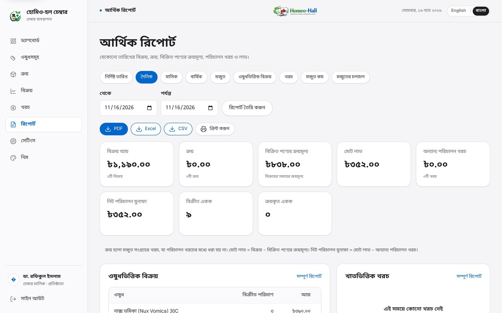

Every report shows sales revenue, purchases, the cost of goods sold, gross profit, operating expenses, net profit and units sold/purchased alongside stock value. The PDF export carries the chamber name and logo.

### Settings, staff and backup

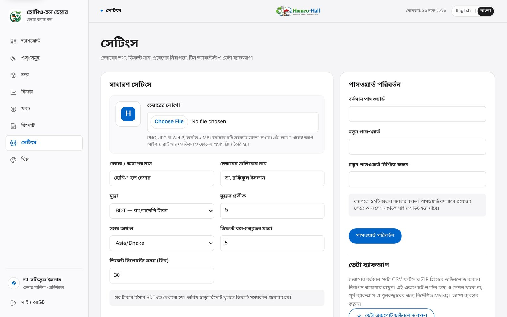

Owners and admins can set the chamber logo (PNG/JPG/WebP, up to 2 MB; square images look best), chamber/app name, owner name, currency (BDT ৳), timezone (Asia/Dhaka), default low-stock level and default report period. Password changes need at least 12 characters and may sign you out on other devices. Only owners can create staff accounts (name, email, designation, 12+ character password) or remove them; removing an account keeps the chamber's history. **Download data export** produces a ZIP of CSV files without login details or passwords — useful for review, but not a full restore; take a MySQL dump for real backups (see [`docs/BACKUP_AND_RESTORE.md`](docs/BACKUP_AND_RESTORE.md)).

### System administration

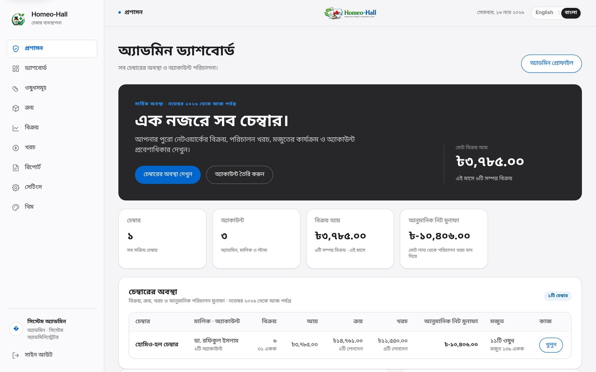

The **Administration** page is visible only to the system admin: it manages chambers and accounts and shows figures across all chambers. Chamber owners and staff never see it.

## Limitations

- XLSX output is a single, clearly formatted worksheet rather than a multi-sheet workbook because the platform lacks `ext-gd`, which PhpSpreadsheet requires. PDF, CSV, and print exports are unaffected.
- The business-data ZIP is an audit/migration aid, not a complete restore format.
- There is intentionally no supplier account module, customer module, payment module, or online ordering.
- The application assumes one owner and one chamber location by design.
